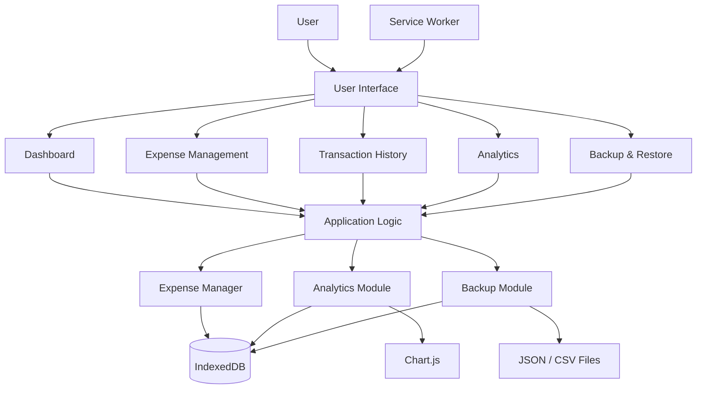
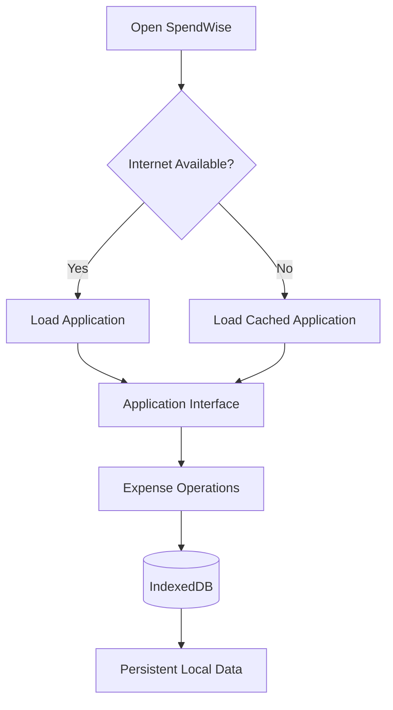

# SpendWise

**Personal College Expense Tracker App**

SpendWise is a personal expense-tracking Progressive Web App (PWA) built to manage and analyze my everyday college expenses.

I built this application for my own use to keep track of where my money goes — whether I spend it at the college tuck shop or outside college.

The application stores data locally in the browser using IndexedDB, so I can manage my expenses without depending on a backend server or an active internet connection.

**Version:** 1.0.0  
**Status:** Initial Release  
**Currency:** INR (₹)  
**Live App:** https://spend-wise-teal-psi.vercel.app/

---

## Features

- **Expense Management:** Add, edit, and delete daily expenses.
- **Dashboard:** View overall, monthly, and daily spending summaries.
- **Analytics:** Analyze spending patterns through charts and calculated averages.
- **Transaction History:** View and manage previously recorded expenses.
- **Location Tracking:** Separate expenses between Tuck Shop and Outside College.
- **Category Tracking:** Organize expenses into Food, Study, Travel, and Other.
- **Backup & Restore:** Export and import expense records in JSON and CSV formats.
- **Themes:** Light and dark mode.
- **PWA Support:** Installable application with offline support.

---

## Technology Stack

| Technology | Usage |
|---|---|
| HTML5 | Application structure |
| CSS3 | Styling and responsive layouts |
| Vanilla JavaScript | Application logic |
| Vite | Development and build tooling |
| IndexedDB | Local database |
| idb | IndexedDB wrapper |
| Chart.js | Data visualization |
| vite-plugin-pwa | PWA and offline support |
| Vercel | Deployment |

---

## System Architecture

SpendWise follows a **client-side, modular architecture**. There is no backend API or remote database in the current version.



### Application Layers

1. **UI Layer:** Dashboard, expense forms, history, analytics, and backup pages.
2. **Application Layer:** Handles navigation, rendering, and communication between modules.
3. **Logic Layer:** Expense operations, analytics calculations, and backup processing.
4. **Storage Layer:** IndexedDB for persistent local expense records.
5. **PWA Layer:** Service-worker caching and installability.

---

## Project Structure

```text
SpendWise/
│
├── public/
│   └── icons/
│
├── css/
│   ├── main.css
│   ├── variables.css
│   ├── theme.css
│   ├── layout.css
│   └── components/
│       ├── sidebar.css
│       ├── navbar.css
│       ├── cards.css
│       ├── expense-modal.css
│       ├── transactions.css
│       ├── analytics.css
│       └── backup.css
│
├── js/
│   ├── main.js
│   ├── app.js
│   ├── theme.js
│   │
│   ├── components/
│   │   ├── sidebar.js
│   │   ├── navbar.js
│   │   ├── expense-modal.js
│   │   └── charts.js
│   │
│   ├── database/
│   │   └── db.js
│   │
│   ├── modules/
│   │   ├── expense-manager.js
│   │   ├── analytics.js
│   │   └── backup.js
│   │
│   ├── utils/
│   │   ├── currency.js
│   │   └── date-utils.js
│   │
│   └── pages/
│       ├── transactions.js
│       ├── analytics.js
│       └── backup.js
│
├── index.html
├── package.json
├── package-lock.json
├── vite.config.js
├── .gitignore
└── README.md
```

### Important Modules

| File | Responsibility |
|---|---|
| `app.js` | Application initialization and navigation |
| `main.js` | Entry point and service-worker registration |
| `db.js` | IndexedDB operations |
| `expense-manager.js` | Expense CRUD and validation |
| `analytics.js` | Spending calculations and breakdowns |
| `charts.js` | Chart.js visualizations |
| `backup.js` | JSON/CSV import and export |
| `theme.js` | Light and dark theme management |

---

## Data Model

Each expense is stored as an individual record in IndexedDB.

| Field | Description |
|---|---|
| `id` | Unique expense ID |
| `amount` | Expense amount in INR |
| `location` | Tuck Shop / Outside College |
| `category` | Food / Study / Travel / Other |
| `note` | Optional expense description |
| `date` | Expense date (`YYYY-MM-DD`) |
| `createdAt` | Record creation timestamp |

### Analytics

The application calculates:

- Overall spending.
- Selected-month spending.
- Today's spending.
- Daily spending breakdown.
- Calendar-day average.
- Active-day average.
- Average per transaction.

### Charts

- Category vs. location grouped bar chart.
- Daily spending trend with average reference line.
- Expense-size histogram.
- Category-wise doughnut chart.

---

## Local Storage & Offline Support

SpendWise uses IndexedDB to store expense records directly in the browser.



- Expenses remain available after refreshing the application.
- Cached application resources support offline access.
- JSON and CSV exports provide manual backups.
- Data is not automatically synchronized between devices.

**Note:** Clearing browser data can remove locally stored expenses. Regular backups are recommended.

---

## Current Version — v1.0.0

Version 1.0.0 focuses on the essential expense-tracking workflow.

### Implemented

- [x] Expense management
- [x] Dashboard and summaries
- [x] Transaction history
- [x] Analytics and charts
- [x] IndexedDB storage
- [x] JSON and CSV backup/restore
- [x] Light and dark themes
- [x] PWA installation
- [x] Offline application support

### Not Yet Implemented

The following pages/features are not included in the current version:

- [ ] **Categories:** Custom category creation and management.
- [ ] **Budget:** Monthly budgets, spending limits, and budget tracking.
- [ ] **Account:** Dedicated account and profile management.

These may be considered for future versions depending on my personal requirements.

---

## Running Locally

### Requirements
- Node.js
- npm

### Setup

```bash
git clone https://github.com/ayushtripathi-45/SpendWise.git
cd SpendWise
npm install
npm run dev
```

### Production Build

```bash
npm run build
npm run preview
```

---

## Personal Note

SpendWise started as a small personal project to solve a simple problem: keeping track of my daily college expenses.

Version 1.0.0 provides the core functionality I need to record expenses, understand my spending habits, and maintain my financial records locally.

**Built for personal use. Developed with a focus on simplicity, privacy, and offline accessibility.**
